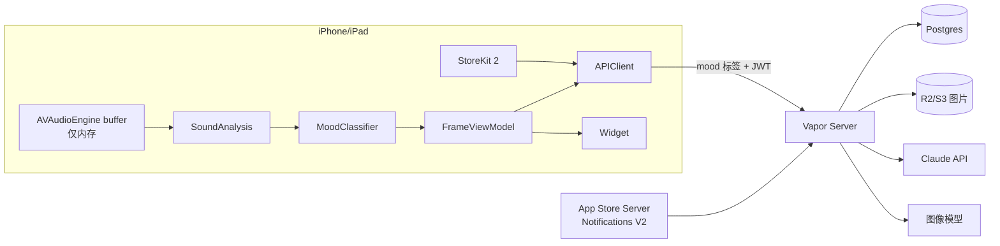
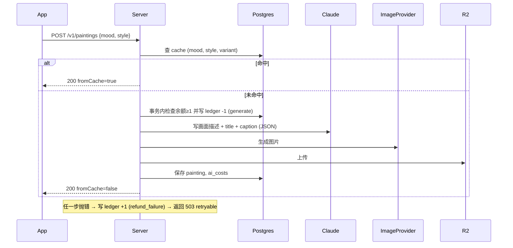

# 设计文档：Calm Frame

> 写给 iOS 开发者的后端说明：后端就是"另一个 Swift 程序"，常驻在云端服务器上，监听 HTTP 请求。Vapor 之于后端，大致相当于 SwiftUI 之于 app：路由（route）≈ 导航目的地，Controller ≈ ViewModel，Fluent 模型 ≈ SwiftData 模型（只不过存在 Postgres 里），Middleware ≈ 每个请求进来前都会跑的拦截器。

## 1. 总体架构



## 2. 共享包 `CalmFrameKit`
App 和 Server 都依赖这个 Swift Package，保证两边的 JSON 结构永远一致。
```swift
public enum Mood: String, Codable, Sendable, CaseIterable { case hectic, noisy, tenseQuiet, drowsy, calm }
public enum PaintingStyle: String, Codable, Sendable { case oilPainting1800s, oldPostcard, gothicNight }
public struct PaintingRequest: Codable, Sendable { public var mood: Mood; public var style: PaintingStyle; public var locale: String }
public struct PaintingResponse: Codable, Sendable { public var id: UUID; public var imageURL: URL; public var title: String; public var caption: String?; public var fromCache: Bool; public var balance: Int }
public struct RedeemRequest: Codable, Sendable { public var signedTransaction: String }
public struct BalanceResponse: Codable, Sendable { public var balance: Int }
public struct AuthRequest: Codable, Sendable { public var identityToken: String }
public struct AuthResponse: Codable, Sendable { public var token: String; public var balance: Int }
```

## 3. iOS 端

### 3.1 聆听与分类
- `AmbienceListener`（actor）：每个周期启动 `AVAudioEngine` 30 秒，tap 的 buffer 直接喂给 `SNAudioStreamAnalyzer`，同时算 RMS 音量；结束后关掉引擎。**没有任何 `AVAudioFile` 写入。**
- 用内置分类器 `SNClassifySoundRequest(classifierIdentifier: .version1)`，关心的标签：`typing`、`speech`、`conversation`、`laughter`、`silence` 等。
- `AmbienceFeatures { typingDensity, speechRatio, meanDBFS, quietDrop }` → `MoodClassifier`（纯函数，便于测试）：

| 条件（按顺序匹配） | Mood |
|---|---|
| meanDBFS > -25 或 speechRatio > 0.5 | noisy |
| typingDensity > 0.4 且 speechRatio > 0.2 | hectic |
| quietDrop 为真 且 meanDBFS < -45 | tenseQuiet |
| typingDensity < 0.1 且 speechRatio < 0.1 且 13:00–16:00 | drowsy |
| 其他 | calm |

阈值写在 `MoodThresholds` 里，调试页可调。防抖：同一 mood 连续 2 个窗口才触发请求。

### 3.2 画面
- `FrameView`：`ZStack { 旧图; 新图.opacity }` + `withAnimation(.easeInOut(duration: 3))` 做 crossfade
- `GildedFrame`：`LinearGradient` 金色 + 内阴影 + 铭牌，纯 SwiftUI，不需要美术素材
- `GhostOverlay`：`TimelineView(.animation)` 驱动一只半透明 SF Symbol/矢量幽灵沿正弦曲线飘过
- 离线兜底：app bundle 内置每种 mood 1 张画，余额为 0 或断网时使用

### 3.3 点数与登录
- `SignInWithAppleButton` → 拿 `identityToken` → `POST /v1/auth/apple` → 保存 server JWT 到 Keychain
- `CreditsStore`：`Product.products(for:)` 加载 `credits.10` / `credits.50`；购买成功后把 `VerificationResult` 的 `jwsRepresentation` 发给后端，后端返回 200 再 `finish()`。启动时遍历 `Transaction.unfinished` 补发。
- 设置 `appAccountToken = userUUID`，便于后端把退款通知对应到用户。

## 4. 后端（Vapor）

### 4.1 一次请求的生命周期（给后端新手）
1. 请求到达 → `RateLimitMiddleware` 检查次数 → `JWTAuthMiddleware` 解出 `userID`
2. 路由分发到 `PaintingsController.create`
3. Controller 调 Service（业务逻辑），Service 用 Fluent 读写数据库
4. 返回 `Content`（就是 `Codable`）→ Vapor 自动编码成 JSON

### 4.2 API

| 方法 | 路径 | 认证 | 说明 |
|---|---|---|---|
| POST | `/v1/auth/apple` | 无 | 验证 Apple identity token，建号，发 starter credits，返回 JWT |
| GET | `/v1/credits` | JWT | 查询余额 |
| POST | `/v1/credits/redeem` | JWT | 兑换 StoreKit 2 交易 |
| POST | `/v1/paintings` | JWT | 生成或取缓存画作 |
| GET | `/v1/paintings/latest` | JWT | 小组件用 |
| POST | `/v1/appstore/notifications` | Apple 签名 | ASSN V2 回调 |
| GET | `/health` | 无 | 部署健康检查 |

### 4.3 数据模型（Fluent）
- `users`：id, appleSub(unique), createdAt
- `ledger_entries`：id, userID, delta(Int), reason(`starter|purchase|generate|refund_failure|apple_refund`), refID(unique per reason，用于幂等), createdAt
  - **余额 = SUM(delta)**，不单独存一个可变的 balance 字段 → 不会出现"加了点数但没记账"的情况
- `purchases`：transactionID(unique), originalTransactionID, productID, credits, userID, revokedAt
- `paintings`：id, cacheKey, mood, style, title, caption, imageKey(S3), promptText, createdAt
- `ai_costs`：id, userID, provider, model, costMicroUSD(Int), paintingID?, createdAt

### 4.4 生成流程



- **缓存键**：`"\(mood)-\(style)-v\(variant)"`，每个组合最多生成 `K=6` 个变体；达到上限后在已有变体中轮换，全部免费。这样常见组合很快就不再花钱。
- **扣点用数据库事务**，`SELECT ... FOR UPDATE` 锁住该用户行，防止并发双花。

### 4.5 可插拔 AI 供应商
```swift
protocol PromptWriter: Sendable { func write(mood: Mood, style: PaintingStyle, locale: String) async throws -> PaintingPrompt }
protocol ImageProvider: Sendable { var name: String { get }; func generate(prompt: String, size: ImageSize) async throws -> (Data, costMicroUSD: Int) }
```
- `ClaudePromptWriter`：调用 Anthropic Messages API，system prompt 约束"19 世纪风景油画/老明信片、无人物、无文字、平静"，要求返回 JSON
- `ImageProvider` 实现通过环境变量 `IMAGE_PROVIDER` 选择（如 `openai`、`replicate`、`fake`）；`fake` 返回本地占位图，用于测试和本地开发

### 4.6 Apple 相关
- **identity token**：用 JWTKit 拉 Apple JWKS 验签，校验 `aud == bundleID`、`iss == https://appleid.apple.com`
- **交易验证**：`SignedDataVerifier(rootCertificates:bundleId:appAppleId:environment:enableOnlineChecks:)` 验证 `signedTransaction`；sandbox 与 production 两个 verifier 都建，按 `environment` 选
- **通知 V2**：同一个 verifier 的 `verifyAndDecodeNotification`；处理 `REFUND`（扣回）和 `REFUND_REVERSED`（加回），其余类型记录日志后返回 200
- 全部按 `transactionId` 幂等

### 4.7 速率限制
内存 token bucket（单实例足够黑客松）；键为 userID。注释里说明多实例时换成 Postgres/Redis。

### 4.8 部署
- `Dockerfile` 多阶段构建；`fly.toml` 或 Render Blueprint
- 托管 Postgres（Fly Postgres / Render Postgres / Neon）
- 启动时 `autoMigrate`；秘密用 `fly secrets set`

## 5. 错误处理
| 场景 | 状态码 | App 行为 |
|---|---|---|
| 余额不足 | 402 | 显示购买入口，相框继续用缓存/内置画 |
| 超限 | 429 | 静默，下一窗口再试 |
| AI 失败（已退点） | 503 | 指数退避重试 1 次 |
| JWT 过期 | 401 | 重新 Sign in with Apple（静默） |

## 6. 测试策略
- `MoodClassifier`：属性测试——任意特征输入都恰好得到一个 Mood；音量单调增加不会从 noisy 变回 calm
- `Ledger`：属性测试——任意 生成/失败/购买/退款 序列后，余额 == starter + 购买 − 成功生成 − Apple 退款
- `XCTVapor`：路由集成测试，使用 `FakeImageProvider` 与 sandbox 测试 JWS
- 隐私测试：在聆听期间断言 app 沙盒没有新增音频文件

## 7. 隐私
App Privacy 标签：不收集音频；收集"用户 ID"（用于点数）。设置页有一句话的隐私说明和 mood 上传示例。
